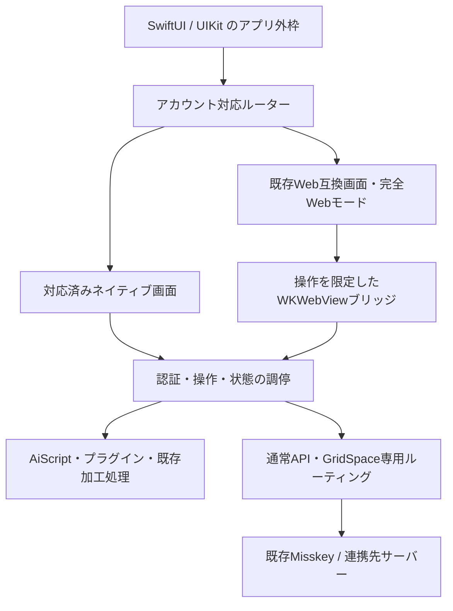

# ぐりすぺ iOSアプリ実装計画

既存PWAの機能を保ちながら、写真選択・投稿・タイムラインを順にネイティブ化する。SwiftUIとUIKitを基本とし、UGCの実行環境、任意CSS、Deck、編集ツール、管理画面にはWKWebViewを残す。Web表示の機能も正式なアプリ機能として扱い、その機能への移動と操作ができる状態を保つ。

## 計画の状態と対象

- 作成日: 2026-11-15 JST。
- リポジトリ: `grid-space-misskey`。基準コミット: `f1bd2e3c4bebf931be8c49342691f03e3cdeb49b`。
- バージョン: `2026.11.0-grid-space.31.33.1`。作業ブランチ: `codex/ios-native-parity-plan`。
- ソース調査と実装計画に加え、[apps/ios/](../../apps/ios/README.md)にWeb互換表示を中心とするiOSアプリの初期実装を追加した。ネイティブのタイムライン・投稿画面、型付きブリッジ、通知サーバーは未実装。iOS SDKでのビルド、実機・本番アカウント・稼働中の外部サービスは未検証。
- 対象は、このコミットのWebクライアントが提供する一般利用、管理・モデレーション、UGC、連携、設定と保存データ。権限や機能設定で非表示のものも一覧に含める。
- ぐりすぺ向けiOSアプリを先に作る。全Misskeyサーバー対応、Android、WidgetKitのホーム画面ウィジェットは別の追加機能であり、今回の完成条件には含めない。iPad、外付けキーボード、画面回転は既存機能の利用に必要な範囲で検証する。
- iOSでの入力・写真・画面遷移を優先するため、GPUIは今回の実装基盤に採用しない。通信・データ処理をRustにする必然性も現時点ではなく、まずSwiftと既存TypeScriptの接続を最小化する。

## 機能を落とさないための条件

「ネイティブ画面が開く」「Web版へのリンクがある」だけでは対応済みにしない。閲覧、作成、編集、削除、設定、保存、復元、共有、権限拒否、通信失敗からの復帰まで、機能ごとに確認する。対応一覧の初期状態は全件「未実装・未検証」である。

| 区分 | 意味 | 切替条件 |
|---|---|---|
| N | ネイティブで提供 | 対応する操作・設定・UGCフック・例外処理の比較試験に合格する |
| H | ネイティブと既存Web処理を併用 | データ、認証、画面遷移、結果の受け渡しを含む比較試験に合格する |
| W | 既存Web機能をアプリ内で提供 | WKWebViewで実際に操作でき、結果と保存状態を確認できる |

全機能はS1のWeb互換モードから移行する。N/Hの表記は移行先の案であり、Webモードから除外してよいという意味ではない。Wを継続する機能も正式な完成形とする。Safariで開くだけの機能はアプリ内での互換性を満たしたとは判定しない。

任意CSSのDOMセレクターやDeckの列配置をネイティブUIで完全に再現することは約束しない。完全Webモードを残して元の見た目と動作を提供する。同じCSSをネイティブモードの全画面にも適用することまで求める場合は、現在の方式では両立しない制約として記録する。

## 機能一覧と調査資料

| 文書 | 内容 |
|---|---|
| [日常操作](daily-features.md) | タイムライン、投稿、MFM、画像加工、通知、チャット、整理・共有など176項目 |
| [ウィジェットとUGC](widgets-ugc.md) | ウィジェット37種類、設定、AiScript、Play、Pages、プラグイン6系統、テーマ・CSS・Deck |
| [画面・設定・管理](routes-settings-admin.md) | 全162ルート宣言と、設定・管理画面の入力項目、ダイアログ、プロフィール内タブ |
| [PWA基盤とGridSpace](platform-gridspace.md) | PWA基盤35項目群、独自連携31項目群、GridSpace API37件 |
| [静的索引と対応方式](catalog-mapping.md) | 設定122キー、状態26キー、ナビ25項目、全ルート・ページの網羅索引 |
| [原本データ](source-inventory.json) | TypeScript ASTから抽出したルート、条件式、設定、登録、ファイル、行番号、ソースハッシュ |
| [検証手順](validation.md) | 今回の調査資料の検証結果と、実装時の比較試験 |

各件数は数える単位が異なるため、足し合わせて「全機能数」としない。162件のルート宣言には親画面、空の子ルート、リダイレクト、フォールバックも含む。テストを除いた259件のページVueにも補助画面やダイアログがある。機能数はルート数より多い。一覧はソースから発見できた操作を記録したもので、実機の全操作を保証するものではない。

実装時には各行に担当、実装PR、比較テストID、確認したOS/端末、N/H/W、検証日、未解決事項を追加する。未知のキーや未対応ルートを破棄しない。サーバーに新機能が加わったら、まずWで利用できる状態を保ち、一覧を更新してから移行する。

## 最終的な分担

| 領域 | 当初 | 目標 | 理由・保持する機能 |
|---|---|---|---|
| 起動、ナビ、アカウント切替、通知からの復帰 | H | N/H | 画面をまたいだ状態と認証を揃える |
| 写真・カメラ・Files・共有・ダウンロード | H | N/H | OS標準操作を使い、元の加工・アップロード処理を保持 |
| タイムライン・通知一覧・プロフィール・検索 | W | N/H | 読んでいる位置を保ち、入力への応答を改善する。連携先ID、全フィルター、非表示規則も保持 |
| 投稿フォーム・下書き・リアクション | W | N/H | 添付・投票・CW・公開範囲・引用・プラグインを含む |
| 高度な画像加工、透かし、フレーム、動画変換 | W | H | 同等の出力を確認するまでは既存ツールを呼ぶ |
| ドライブ、チャンネル、リスト、アンテナ、クリップ、チャット | W | N/H | 一覧表示だけで終わらせず、管理・編集・権限・リンク先まで移行 |
| 標準ウィジェット | W | N/H/W | 37種ごとの表に従う。スクリプト実行・外部iframe・ゲームを例外扱いで省かない |
| AiScript、Play、Pages編集、Scratchpad | W | W/H | 現行と旧版の言語・host API・保存・編集機能を維持 |
| テーマ、任意CSS、Deck、ナビ・ステータスバー編集 | W | W/H | 完全Webモードを維持。色トークンのみ必要に応じてネイティブへ対応 |
| 管理、モデレーション、詳細セキュリティ、移行・インポート | W | W | 使用頻度より正確さを優先。権限を狭めたり確認を省いたりしない |
| 3D、Gaussian splat、AvatarWalk、ゲーム、外部コンテンツ | W | W/H | 描画・音声・保存データを保持。専用画面単位でWebを使う |

## 構成

### 画面と遷移

SwiftUIがアプリの画面スタックを持ち、UIKitを長い一覧、投稿入力、画像表示へ使う。URLはhost、アカウント、リソース種別、ローカルID、連携元ID、query、fragmentを保持して解析する。ネイティブ対応済みならその画面へ、未対応なら同じ認証文脈のWeb画面へ遷移する。外部リンクは別のブラウザ文脈に分離する。

WebViewは原則としてウィジェット画面、Play、編集ツールなど画面単位で持つ。投稿1件ごと、標準ウィジェット1個ごとに無制限のWebViewを作らない。混在ボードの高さ・スクロール・ジェスチャーが成立しない場合は、ボード全体をWに戻す。Web表示を開くたびに起動し直す構成も避け、必要な状態だけを保存して再利用・復元する。

### 認証

`ApiCallService`の`secure`判定は、認証ユーザーがいて`MiAccessToken`ではない場合に成立する。[判定](../../packages/backend/src/server/api/ApiCallService.ts)、[認証処理](../../packages/backend/src/server/api/AuthenticateService.ts)。ここでいうnative user tokenはMisskeyの資格情報の種類で、iOSアプリという意味ではない。MiAuthで取得したtokenでは多数のGridSpace API、詳細セキュリティ設定、Web Push登録を呼べない。

S1では既存Webの正規ログインをWKWebView内で行う。SafariのlocalStorage、Cookie、IndexedDBが自動移行するとは仮定しない。パスワード、TOTP、バックアップコード、パスキー、CAPTCHA、再認証を確認し、システム認証画面へ渡す必要がある経路は復帰方法まで設計する。

S3の第一案は認証済みの信頼するWeb外枠で定義済みの操作だけを実行し、結果をネイティブへ返す方式である。全権トークンをURL、任意のJavaScript、外部iframe、ログへ渡さない。ネイティブから直接呼び出す必要がある操作は、通常のMiAuthで許可されるか、新設の第一者向け・用途限定セッションが必要かをAPI単位で分類する。後者は独立した認証設計とテストを要する。`secure: true`を外すこと、User-Agentや単なるクライアントフラグで信用すること、汎用のAPI中継を公開することは禁止する。

同じoriginにあるJavaScriptをすべて信頼できるとは考えない。外枠の操作ハンドラーとUGC実行環境は区別し、UGCには既存のhost APIだけを公開する。主トークンの取得や管理操作に使えるブリッジは設けない。ログアウト・アカウント切替・リンク撤回時には、待機中の操作、コールバックID、表示データを失効させる。

### ブリッジの通信仕様

最初から任意のJavaScript実行や`api(endpoint, params)`を公開せず、次の操作群を型付きで定義する。SwiftのCodableとTypeScriptでスキーマを共通化し、起動時にバージョンと対応機能を確認する。

| 操作群 | 入出力と制約 |
|---|---|
| `capabilities` / `ready` | プロトコル・Web・スキーマのバージョン、利用可能機能、現在のaccountEpochを交換する。未対応のバージョンならWへ戻す |
| `navigation.open` | 同一サービスの型付き参照または許可URL。外部originへbridgeを引き継がない |
| `media.pick` / `media.open` / `media.export` | request ID、添付候補ID、MIME、ファイル名、サイズ、順序、取消を扱う。所有アカウントを検証し、一時ファイルの保持期間を管理する |
| `draft.read/update` | draft IDとrevisionを伴う差分。古いrevisionの上書きを拒否。新規/返信/引用/チャンネル/連携先の文脈を保持 |
| `plugins.processDisplay/processPost` | 実行環境にクロージャーを保持し、直列に処理する。結果またはnull、プラグイン例外、通信障害を区別する |
| `plugins.invokeAction` | 実行環境が発行したコールバックIDと対象を指定する。後からのフォーム更新も継続して通知する |
| `preferences.read/patch` | 所有するキーだけを更新する。スコープ、未知のキー、プロファイルのrevision、クラウド設定を保持する |
| `state.invalidate` | 投稿・既読・リアクション・権限の変更を通知。全ノートの二重購読を避ける |
| `session.changed` | host、user ID、accountEpoch。epochの古い返答を表示も保存もしない |

各メッセージに`protocolVersion/requestId/accountEpoch/operation/payload`を付ける。応答は成功、取消、拒否、期限切れ、結果不明を区別する。origin、main-frame、現在のWebViewセッション、操作種別、入力スキーマを検証する。`WKContentWorld`はJS変数を分離する仕組みであり、DOMや同じデータストアを完全に隔離するものとして扱わない。S1で最小限の通信仕様、入力検証、起動時の対応バージョン確認を実装し、S2の写真選択もその仕様に従って追加する。安全性の確保をS3まで先送りしない。

### UGCとプラグイン

`button`を含むAiScriptウィジェット、Playの新旧言語、Pages、Scratchpadを既存の実行環境で動かす。`AsUi`の14ノードをネイティブで描画する案は後の追加段階で扱い、当初は既存Web表示を使う。コールバックは実行環境に残し、セッション内だけで有効なIDと値をやり取りする。JavaScript関数をJSON化しない。未対応ノードがあれば画面全体をWへ戻す。

プラグインの6フックと旧名のエイリアスを保持する。表示前加工の結果がnullなら非表示にし、加工前の本文を先に描かない。投稿前加工は現行の順序で一度だけ通す。プラグイン例外は現在の各フックのcatch・ログ出力・続行動作に合わせる。一方、新たに生じるブリッジ切断やタイムアウトでは未加工の投稿を勝手に送らず、下書きを残す。実行IDと結果を記録して同じ実行環境への重複要求を抑止するが、任意のプラグインAPIの副作用まで一度限りにできるとは保証しない。プロセス終了・応答喪失をまたぐ場合は結果不明とし、自動で再実行しない。APIごとの照合、または利用者による確認を要する。詳細は[UGC付録](widgets-ugc.md)を参照する。

既存Webはdocumentごとにプラグインを起動するため、複数のWebViewをそのまま常駐させると二重実行になる。アカウントごとに実行環境の所有者を一つ定め、描画側のWebViewには受動モードを追加する。受動モードではプラグインの起動、重複する全体購読、全体タイマーを抑止し、必要な操作を所有者へ委譲する。完全Webモードへの切替時も所有者を引き継ぐか、停止してから交代する。ウィジェット内のスクリプトはウィジェットIDごとのインスタンスで管理し、既存の画面単位の副作用と区別して試験する。

### 写真選択とアップロード

S2では写真選択にPhotosUIを使い、カメラとFilesもOSのUIから操作する。ローカル一時ファイルと順序付きのマニフェストを作り、Webの`File[]`相当へ渡す経路を用意する。`WKUIDelegate`のopen-panel拡張はiOS 18.4以降で使えるため、対応バージョンでは採用候補とする。それより前のOSも対象にする場合は、明示的な`media.pick`アダプターを実装して検証する。最低対応OSはS1で対応端末を確認して決める。

画像本体をbase64にして大量のメッセージで送信しない。選択ファイルだけを読み出せる一時ハンドルとチャンク転送の経路を設け、キャンセル、iCloudからの遅延取得、メモリ警告、アプリ復帰、対象アカウントの変更に対応する。既存の切り抜き、リサイズ、効果、透かし、フレーム、圧縮、キャプション、センシティブ設定、フォルダ指定、GridSpace私有アップロードの処理を通す。ネイティブから先にアップロードしてDriveFile IDだけを返す方式は、それらの前処理を省くため当初は採らない。

S4でアップロードをネイティブ化する際も、未移植の編集ツールはWで呼べるようにする。background URLSessionの永続キューに入れるのは、利用者自身が選んだ未送信の添付と、保存を許可された公開ファイルに限る。取得した私有投稿の添付を転用して永続キューへ入れない。私有投稿の送信ジョブはアカウントの変更・アクセス許可の失効時に中止し、一時ファイルと失効した資格情報を破棄する。再開時には認可と既存ジョブの結果を確認する。強制終了後も必ず続くとは説明しない。`notes/create`の応答が失われた場合は「結果不明」で止める。一般投稿には既存の冪等キーがあると仮定しない。GridSpace側にrequest ID/statusがある経路では、既存の仕様を使う。

### 保存と同期

永続設定、セッション状態、UGCの保存データ、添付、私有データを分ける。`PreferencesProfile`のscope/value/meta、122設定キー、26状態キー、未知のフィールドの生データを保つ。アプリ内のネイティブとWebがそれぞれ全体を書き戻す方式は禁止し、差分とrevisionを扱う一つの調停処理に集約する。ただし、現在のcloud registry同期には、外部PWAとの競合を原子的に解消する仕組みがない。S3で比較・更新APIへのCAS/version追加を検討する。追加しない場合は、クラウドでの同時編集の衝突を検出して利用者に示し、PWAとの完全な競合防止を保証しない。既存PWAも更新するまで競合条件が残ることを明記する。

PWAからの移行は設定プロファイルだけでは終わらない。ローカル下書き、チャット下書き、AiScriptストレージ、memo、VRM/AvatarWalkのIndexedDBなどは別に移行する。PWA側に、利用者の操作でエクスポートして一度だけ引き渡す機能を設ける。出力内容を一覧で確認してからアプリがインポートする。認証情報とプラグイントークンはエクスポートせず、再認証する。元データを消さず、未知のキーとblobを含むデータの往復を合成データで確認する。

GridSpace私有ノートの本文・人物・添付は、既存方針どおり通常キャッシュへ保存しない。バックグラウンドへの移行・リンク撤回時は本文を破棄し、許可された参照だけを残して復帰時に再認可する。UIKitの画像キャッシュ、URLCache、アプリ切替時のスナップショットにも同じ制約を適用する。Webコンテンツのプロセスが終了した場合に復元する下書きと、復元してはいけない私有データを区別する。

### 通信と通知

IDは`{host, account, kind, localId, sourceId, uri, context}`として扱う。通常APIとGridSpaceのmanaged/private APIを共通のルーティング層で選び、連携元IDをローカルAPIへ渡さない。localとpaired homeの並び順、同時刻境界、canonical URI重複排除、ページング完了条件を既存処理から引き継ぐ。

WebSocketはフォアグラウンドで購読し、バックグラウンドで止める。復帰後は差分を取得して整合させる。フォアグラウンドでの二重購読・二重通知を避け、連携先での失敗を空配列や未読0に変換しない。

APNsは独立したサーバー作業として、端末登録・削除、user/device/topic/environmentの関連付け、送信、無効トークンの処理、既読同期を実装する。端末登録には、認証済みWebが発行を要求する一回限りのチャレンジ等を使う案を検証し、任意のアカウントを登録できない設計にする。プロバイダー鍵はサーバーだけに置く。Web Pushの20通知種別と操作、アンテナ、チャット、既読同期をAPNsへ対応付ける。同じアプリのインストール単位で、安定したイベントIDを使って二重表示を抑止する。別に利用しているSafari PWAや別端末の購読は、利用者が解除しない限り維持する。アプリ登録を理由に全Web Pushを停止しない。通知のプライバシーと解除時の挙動を揃える。

現在のSWはオフライン時の案内とロケールのキャッシュが中心で、タイムライン全文を保存するものではない。S1でこの動作を確認し、将来のオフライン閲覧は別機能として設計する。特に私有投稿の永続保存を追加しない。

## 実装する順序と作業単位

日数は実機の認証・UGC・ストレージ検証前に確約しない。各作業は一つずつレビューできる変更に分ける。括弧内のパスは新設候補であり、今回作成したコードではない。

| ID / 段階 | 成果物・主な対象 | 依存 | 受入条件 |
|---|---|---|---|
| S0-1 | 本一覧と原本、更新差分の検出（本ディレクトリ） | なし | 一覧に欠落がなく、日常操作176行・ウィジェット37種・全ルートを確認する |
| S0-2 | 現行PWAの合成データと動画・画面・保存結果（`tests/ios-parity/`候補） | S0-1 | 未ログイン・一般利用者・モデレーター・管理者・連携済みの基準動作を区別できる |
| S0-3 | UGC実行と配布方式の適合性確認 | S0-1 | Apple 4.7/4.7.2と既存UGCの関係、公開可能なブリッジ操作を整理する。機能を削除しないと進められない場合は方針を相談する |
| S1-1 | iOSプロジェクト、CI、署名手順、最低対応OS（`apps/ios/`候補） | S0 | Mac/Xcodeからシミュレーター・実機で起動でき、権限を拒否しても起動できる |
| S1-2 | CompatibilityWebHost、URL解析と遷移先の解決、完全Webモード、復帰 | S1-1 | 162宣言の代表実体URL・全query・fragmentを扱え、別画面窓を開ける |
| S1-3 | Webの正規ログイン、アカウント切替、秘密情報の分離 | S1-2 | secure API、2FA・パスキー・CAPTCHA・再認証・退出の動作が基準と一致する |
| S1-4 | 最小限のブリッジスキーマと検証、対応バージョン確認、PWAデータのエクスポート・インポート、障害回復 | S1-3 | origin・frame・epoch・操作を制限でき、設定・下書き・UGC・blobを欠落なく往復できる |
| S2-1 | PhotosUI・カメラ・Filesによる選択と転送アダプター | S1-4 | 検証済みブリッジと有効期限付きハンドルを使い、順序・再選択・取消・遅延・大容量ファイルを既存アップローダーで扱える |
| S2-2 | 共有シート、Share Extension、エクスポート・ダウンロード | S2-1 | `/share`の全パラメーター、ファイルの保存名・形式・失敗時の挙動が一致する |
| S3-1 | ブリッジのスキーマ・レジストリ・権限・accountEpochの拡充（`packages/ios-bridge/`候補） | S0-3/S1-4 | 不正なorigin・frame・epoch・操作を拒否し、旧Web版へ退避できる |
| S3-2 | 設定・下書き・エンティティ・無効化の共通処理 | S3-1 | 同時変更・切替・復帰で上書きや漏えいが起きない |
| S3-3 | AiScript実行環境の所有者、受動Webモード、プラグイン6フック、コールバック連携 | S0-3/S3-1/2 | null・例外・連続加工・副作用・取消・新旧言語の挙動を確認し、Webモード切替時に二重起動しない |
| S3-4 | APIの認証分類と第一者向け認証案、APNsの登録設計 | S1-3 | secure規則を弱めずに必要な操作ができる。未達なら該当機能のN化へ進まない |
| S4-1 | NativeTimeline、ページング、ノート描画、メディア表示 | S3 | MFM・絵文字・全フィルター・連携・私有ノート・アクション・既読位置が一致する |
| S4-2 | NativeComposer、下書き、投票・CW・公開範囲、プラグイン、アップロード | S2/S3/S4-1 | 日常操作176行のうち投稿関連の全項目、加工用Web画面への遷移、結果不明時の処理が一致する |
| S4-3 | NativeNotificationsとAPNsプロバイダー | S3-4 | 通知種別・操作・アカウント・既読・解除・重複防止の挙動が一致する |
| S5-1 | プロフィール・検索・ドライブ・コレクション・チャット | S4 | 子タブ・管理・権限・連携先へのルーティングまで、各表の条件を満たす |
| S5-2 | 標準ウィジェット37種とボード管理 | S3/S4 | 一覧・設定・生データ・配置・外部依存を保持する。W/Hも正式な対応方式とする |
| S5-3 | Webで継続する領域の仕上げ | S1/S3 | 管理、CSS、Deck、Pages/Play編集、3D/ゲームを実際に操作できる |
| S6-1 | 全一覧の回帰試験・性能・アクセシビリティ・障害試験 | S1–5 | 下記の完了条件を満たす |
| S6-2 | UGC配布条件・説明資料・TestFlight/App Storeへの提出準備 | S6-1 | 制約を満たし、ユーザーが提出を指示できる状態になる |

S1の結果でWKWebViewの必須機能が不足した場合は、該当機能のOS連携を先に補う。機能を消して次段階へ進まない。S4のネイティブ画面は機能単位のスイッチで有効化し、問題があればその画面だけWへ戻す。Webへ戻っても下書きや現在位置を失わないことを試験する。

S3以降はiOS、Webアダプター、バックエンドを分担できるが、認証・ブリッジスキーマ・テストデータを先に確定する。実装担当が異なっても、API仕様を各自で変更しない。

## 完了条件と試験

- 全機能行にN/H/Wと実機の比較結果がある。未検証、Webで開くだけ、恒常的なSafari退避を合格としない。
- 設定122キー、状態26キー、ウィジェット37種類、ルート162宣言、ページ259ファイル、ナビゲーション25項目、個別起動7プレフィックスについて、対応状況と保留理由を記録する。無関係な補助処理を機能数に数えない。
- 非公開、CW、年齢/権限/移行制限、連携先停止、token失効を含む。アプリがサーバー権限を独自に緩めない。
- 写真選択→加工→投稿、投稿→詳細→戻る、ウィジェット→投稿、通知→別アカウント→戻るの操作で状態を保つ。多量の画像・長いMFM・絵文字・3Dを含める。
- Webプロセスの終了、アプリのバックグラウンド移行、OSによる強制終了、利用者による強制終了、ネットワークの遅延・切断・タイムアウト・429・5xxを区別する。下書きは失わず、権限付きの私有本文は残さない。
- 同じ合成データをPWAとiOSへ入力し、表示文字、加工後のペイロード、設定、順序、API呼び出し、保存データを比較する。ピクセルの一致ではなく意味と操作の一致を基本とし、CSS/DeckはWeb表示で視覚的に比較する。
- 日本語IME、選択・貼付、VoiceOver、Dynamic Type、Reduce Motion、ダークモード、片手戻り操作、外部キーボードを検証する。
- 性能目標案: 60Hz端末で主操作の95%のフレームを16.7ms以内、操作反映を100ms以内とする。画像付き1,000件をスクロールしても、メモリ使用量が増え続けないことを目指す。PWAとの同一端末比較で決め、これらの数値を達成済みとは表示しない。120Hzは別に計測する。
- 通知・写真・Files・WebAuthnはMacのシミュレーターだけでなく、実機での確認を必須とする。

[詳細のチェックと現時点の結果](validation.md)へ記録する。バックエンドのエンドポイントを新設する際はOpenAPI/misskey-jsを再生成する。マイグレーションでは新しいup/downとスキーマ検査を、フロントエンドでは該当する単体・ブラウザ・e2eテストを追加し、リポジトリのshippingスキルに従って確認する。

## 未確定事項と採る順序

1. 最低対応OS: S1で保有端末・WebKit能力を調査する。iOS18.4のopen-panel APIを使える端末だけに限定するかは未決定。古い端末を無断で対象外にしない。
2. 第一者向け認証: S1でWebのsecure操作を正規ログイン状態で実行できることを確認し、S3で限定bridgeか新セッション契約を決める。MiAuthだけで完成できる前提を置かない。
3. PWAデータ移行: 既存export対象外のblobとAiScriptデータを試作で検証し、利用者の同意と確認付きで移す。Safariの保存領域を直接読めると仮定しない。
4. UGCとストア配布: Apple 4.7のmini app/pluginに該当する範囲、4.7.2のnative API公開、4.7.3の個別同意、1.2の通報/ブロック、2.5.2のコード更新、4.2の最低機能を設計時に確認する。WKWebViewなら自動的に許可されるとは判断しない。機能削除で対処する前に配布方針を相談する。
5. 外部サービス: Resonite統計/イベント/放送/Live2D/ビープ/ぞうの認証・音声・origin制約は実動作未確認。失敗時表示を含めて検証する。
6. 稼働環境との差分: 本番の有効設定や最新のデプロイバージョンが基準コミットと同じかは未確認。S0-2でバージョンを記録して差分を一覧へ追加する。

本計画の作成はコードの実装・本番設定の変更・通知鍵の発行・App Storeへの提出の承認ではない。実装作業を始める際は、この一覧を基にS0-2とS1から進める。

## 参照した一次資料

いずれも2026-11-15に確認。以下はOS能力・配布条件の根拠であり、このアプリでの動作確認ではない。

- [WKWebView](https://developer.apple.com/documentation/webkit/wkwebview): Web UI、navigation/UI delegate。
- [WKScriptMessageHandlerWithReply](https://developer.apple.com/documentation/webkit/wkscriptmessagehandlerwithreply): 非同期メッセージと応答。
- [WKContentWorld](https://developer.apple.com/documentation/webkit/wkcontentworld): JS変数の分離とDOM共有の制約。
- [WKWebsiteDataStore](https://developer.apple.com/documentation/webkit/wkwebsitedatastore): Webデータの永続化・profile分離。
- [Web content process終了](https://developer.apple.com/documentation/webkit/wknavigationdelegate/webviewwebcontentprocessdidterminate(_:)): process終了後の復帰通知。
- [Photos picker](https://developer.apple.com/documentation/photokit/selecting-photos-and-videos-in-ios): 複数選択・再選択・非同期取得。
- [open-panel delegate](https://developer.apple.com/documentation/webkit/wkuidelegate/webview(_:runopenpanelwith:initiatedbyframe:completionhandler:)): iOS18.4以降のupload panel差し替え。
- [background URLSession](https://developer.apple.com/documentation/foundation/urlsessionconfiguration/background(withidentifier:)): background転送と利用者による強制終了の制約。
- [APNs端末登録](https://developer.apple.com/documentation/usernotifications/registering-your-app-with-apns): device tokenとprovider。
- [パスキー](https://developer.apple.com/documentation/authenticationservices/supporting-passkeys): associated domainの条件。
- [App Review Guidelines](https://developer.apple.com/app-store/review/guidelines/): 1.2、2.5.2、4.2、4.7。
